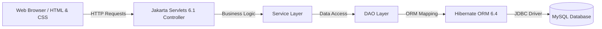

# 📚 Library Management System

[](https://www.oracle.com/java/)
[-red.svg?logo=jakartaee&logoColor=white)](https://jakarta.ee/)
[](https://hibernate.org/)
[](https://www.mysql.com/)
[](https://tomcat.apache.org/)
[](https://maven.apache.org/)
[](LICENSE)

A full-stack, enterprise-grade **Library Management System** built with **Java 17**, **Jakarta Servlets**, **Hibernate ORM**, and **MySQL**, designed to run on **Apache Tomcat 10.1.x**.

Live- https://library-management-system-g6kt.onrender.com

The application offers complete end-to-end automation for modern libraries—featuring role-based dashboards (Admin & Member), book inventory tracking, member profile management, dynamic borrowing & return workflows, automated stock counter adjustments, and overdue fine calculations.

---

## 📑 Table of Contents

- [Key Features](#-key-features)
- [Architecture & Tech Stack](#-architecture--tech-stack)
- [Project Structure](#-project-structure)
- [Core Business Rules](#-core-business-rules)
- [Application Pages & Endpoints](#-application-pages--endpoints)
- [Database Configuration](#-database-configuration)
- [Prerequisites](#-prerequisites)
- [Installation & Setup](#-installation--setup)
- [Running via IntelliJ IDEA / Smart Tomcat](#-running-via-intellij-idea--smart-tomcat)
- [Security & Deployment Notes](#-security--deployment-notes)
- [Future Roadmap](#-future-roadmap)
- [License](#-license)

---

## ✨ Key Features

### 🔐 Authentication & Role-Based Access Control (RBAC)
- Secure session-based authentication (`/login`, `/logout`, `/dashboard`).
- Role-specific access separation:
  - **Administrator:** Full administrative rights for book inventory, member records, issuing, returns, and library-wide audits.
  - **Member:** Read-only access to catalogue, personal borrowing records, currently loaned books, and calculated fines.
- Server-side access control protecting administrative endpoints.

### 📖 Book Inventory Management
- **Add New Books:** Title, author, ISBN, category, total copies, and available copies.
- **Catalogue & Search:** Browse book inventory with live stock counters.
- **Edit & Update:** Modify book metadata and copy counts.
- **Delete:** Safely remove unreferenced book records.
- **Auto-Inventory Adjustment:** Available copies automatically decrement upon issue and increment upon return.

### 👥 Member Management
- Add, update, and remove library member profiles.
- Track member attributes: Full Name, Membership ID, Phone Number, Address, and associated User ID.

### 🔄 Book Issuing & Return Workflow
- **Issue Books:** Issue available books to verified members with instant inventory deduction.
- **Return Processing:** Mark borrowed items returned; copies are automatically restored to circulation.
- **Borrowing Limit Protection:** Prevents members from borrowing more than the configured active book limit.

### 💰 Overdue Fine Engine
- Dynamic calculation of overdue fines based on due date vs. return date.
- Real-time overdue alerts and fine balance view for members.

### 🎨 Modern UI & Experience
- Responsive sidebar-based design with navy-blue theme and crisp typography.
- Standardized forms, status badges, action buttons, and responsive data tables across all views.
- Clean feedback states with human-readable success and error alerts.

---

## 🛠️ Architecture & Tech Stack



| Layer | Technology | Details |
|---|---|---|
| **Language** | Java 17 (LTS) | Modern object-oriented backend |
| **Web Tier** | Jakarta Servlet API 6.1 | Web controllers and dynamic HTML rendering |
| **Data Persistence** | Hibernate ORM 6.4.4.Final | Entity mapping, sessions, transactions, and criteria |
| **Database** | MySQL (Connector/J 9.7.0) | Relational database storage |
| **Servlet Container** | Apache Tomcat 10.1.x | Jakarta EE 10 compliant server |
| **Build Tool** | Apache Maven | Project lifecycle and dependency management |
| **Frontend** | HTML5, CSS3, JavaScript | Navy-blue design system (`style.css`), responsive layouts |
| **Tooling** | IntelliJ IDEA / Smart Tomcat, MySQL Workbench | Recommended IDE and database GUI |

---

## 📁 Project Structure

```text
library-management-system/
├── pom.xml                               # Maven project configuration and dependencies
├── PRD.md                                 # Product Requirements Document
├── README.md                              # Project documentation
└── src/
    └── main/
        ├── java/
        │   └── com/
        │       └── library/
        │           ├── TestHibernate.java # Database connectivity & Hibernate verification
        │           ├── dao/               # Data Access Objects (CRUD operations)
        │           ├── model/             # Hibernate JPA Entity classes
        │           │   ├── Book.java          # Book entity (ISBN, title, author, copies)
        │           │   ├── BookIssue.java     # Issue/Borrow record & fine tracking
        │           │   ├── Member.java        # Member profile entity
        │           │   └── User.java          # User credentials & role (ADMIN / MEMBER)
        │           ├── service/           # Business logic & validation services
        │           ├── servlet/           # Jakarta HTTP Servlets (Controllers)
        │           │   ├── AddBookServlet.java
        │           │   ├── AddMemberServlet.java
        │           │   ├── BookIssueServlet.java
        │           │   ├── BookListServlet.java
        │           │   ├── BorrowingHistoryServlet.java
        │           │   ├── DashboardServlet.java
        │           │   ├── DeleteBookServlet.java
        │           │   ├── DeleteMemberServlet.java
        │           │   ├── EditBookServlet.java
        │           │   ├── EditMemberServlet.java
        │           │   ├── LoginServlet.java
        │           │   ├── LogoutServlet.java
        │           │   ├── MemberListServlet.java
        │           │   ├── MyBorrowedBooksServlet.java
        │           │   ├── MyBorrowingHistoryServlet.java
        │           │   ├── MyFinesServlet.java
        │           │   ├── ReturnBookServlet.java
        │           │   └── UpdateBookServlet.java
        │           └── util/              # Utility classes (HibernateUtil, DB helpers)
        ├── resources/
        │   └── hibernate.cfg.xml         # Hibernate DB connection & mapping configuration
        └── webapp/
            ├── WEB-INF/
            │   └── web.xml               # Web application deployment descriptor
            ├── index.html                # Landing page
            ├── login.html                # User login portal
            ├── admin-dashboard.html      # Administrator control center
            ├── member-dashboard.html     # Member self-service portal
            ├── add-book.html             # Add new book form
            ├── add-member.html           # Register new member form
            ├── issue-book.html           # Issue book to member form
            ├── return-book.html          # Book return processing form
            └── style.css                 # Unified stylesheet & design system
```

---

## ⚖️ Core Business Rules

1. **Borrowing Limit:** A member can hold a maximum of **5 active borrowed books** simultaneously.
2. **Loan Period:** Standard borrowing duration is **14 calendar days** from the issue date.
3. **Overdue Fine Rate:** Overdue books incur a fine of **₹5 per day** for each day past the due date.
4. **Inventory Integrity:**
   - Books cannot be issued if `availableCopies <= 0`.
   - Issuing a book decrements `availableCopies` by 1.
   - Returning a book increments `availableCopies` by 1.
5. **Authorization:** Administrative actions (Add/Edit/Delete Books, Member Management, Issue, Return) require valid `ADMIN` session authorization.

---

## 🌐 Application Pages & Endpoints

### 🖥️ Client Web Pages (`/webapp`)

| Page | URL Path | Access | Description |
|---|---|---|---|
| Landing Page | `/index.html` | Public | Welcome screen with quick login access |
| Login Page | `/login.html` | Public | Authentication form (Email & Password) |
| Admin Dashboard | `/admin-dashboard.html` | Admin | Administrative analytics & operations hub |
| Member Dashboard | `/member-dashboard.html` | Member | Member portal for catalogue & borrowings |
| Add Book | `/add-book.html` | Admin | Form to add new title to catalogue |
| Add Member | `/add-member.html` | Admin | Form to register a library member |
| Issue Book | `/issue-book.html` | Admin | Form to issue book using Book ID & Member ID |
| Return Book | `/return-book.html` | Admin | Form to process returns by Issue ID |

### ⚡ Servlet Controller Endpoints

| Endpoint | HTTP Method | Allowed Role | Handler Servlet | Description |
|---|---|---|---|---|
| `/login` | `POST` | Public | `LoginServlet` | Authenticates credentials & sets user session |
| `/logout` | `GET` | Authenticated | `LogoutServlet` | Invalidates session and redirects to login |
| `/dashboard` | `GET` | Authenticated | `DashboardServlet` | Role-based router redirecting to correct dashboard |
| `/books` | `GET` | Admin / Member | `BookListServlet` | Renders book catalogue (action buttons for Admin) |
| `/add-book` | `POST` | Admin | `AddBookServlet` | Persists a new book record |
| `/edit-book` | `GET` | Admin | `EditBookServlet` | Displays pre-filled edit form for book |
| `/update-book` | `POST` | Admin | `UpdateBookServlet` | Saves updated book information |
| `/delete-book` | `GET` / `POST` | Admin | `DeleteBookServlet` | Removes book from inventory |
| `/members` | `GET` | Admin | `MemberListServlet` | Displays table of all registered library members |
| `/add-member` | `POST` | Admin | `AddMemberServlet` | Creates a member record |
| `/edit-member` | `GET` / `POST`| Admin | `EditMemberServlet` | Updates member profile details |
| `/delete-member`| `GET` / `POST`| Admin | `DeleteMemberServlet` | Removes member record |
| `/issue-book` | `POST` | Admin | `BookIssueServlet` | Validates limits & issues book |
| `/return-book` | `POST` | Admin | `ReturnBookServlet` | Processes book return & calculates fines |
| `/borrowing-history` | `GET` | Admin | `BorrowingHistoryServlet` | Displays complete library borrowing records |
| `/my-borrowed-books` | `GET` | Member | `MyBorrowedBooksServlet` | Shows currently active loans for member |
| `/my-borrowing-history` | `GET` | Member | `MyBorrowingHistoryServlet` | Shows lifetime borrowing history for member |
| `/my-fines` | `GET` | Member | `MyFinesServlet` | Displays unpaid & historical fine breakdown |

---

## 🗄️ Database Configuration

### 1. Create MySQL Database
Open your MySQL client or MySQL Workbench and run:

```sql
CREATE DATABASE IF NOT EXISTS library_management CHARACTER SET utf8mb4 COLLATE utf8mb4_unicode_ci;
```

### 2. Configure `hibernate.cfg.xml`
Locate [`src/main/resources/hibernate.cfg.xml`](file:///Users/krish/Desktop/library%20management%20system/src/main/resources/hibernate.cfg.xml) and update your database credentials:

```xml
<property name="hibernate.connection.driver_class">com.mysql.cj.jdbc.Driver</property>
<property name="hibernate.connection.url">jdbc:mysql://localhost:3306/library_management</property>
<property name="hibernate.connection.username">YOUR_MYSQL_USERNAME</property>
<property name="hibernate.connection.password">YOUR_MYSQL_PASSWORD</property>

<property name="hibernate.dialect">org.hibernate.dialect.MySQLDialect</property>
<property name="hibernate.show_sql">true</property>
<property name="hibernate.format_sql">true</property>
<property name="hibernate.hbm2ddl.auto">update</property>
```

> [!NOTE]
> `hibernate.hbm2ddl.auto` is set to `update`. Hibernate will automatically create or update the required tables (`users`, `members`, `books`, `book_issues`) on first run.

---

## ⚙️ Prerequisites

Ensure you have the following installed on your machine:
- **Java Development Kit (JDK):** Version 17 or higher (`java -version`)
- **Apache Maven:** Version 3.8+ (`mvn -version`)
- **MySQL Server:** Version 8.0 or 9.x (`mysql --version`)
- **Apache Tomcat:** Version 10.1.x (Jakarta EE 10 compatible)
- **IDE:** IntelliJ IDEA (Ultimate or Community) or Eclipse

---

## 🚀 Installation & Setup

### 1. Clone the Repository
```bash
git clone https://github.com/your-username/library-management-system.git
cd library-management-system
```

### 2. Verify Database Connection
Run the standalone Hibernate test runner to verify database connectivity and auto-generate schema:
```bash
mvn compile exec:java -Dexec.mainClass="com.library.TestHibernate"
```

### 3. Build the WAR Package
Build the project and produce the `.war` deployment file:
```bash
mvn clean package
```
This generates `target/library-management-system.war`.

---

## 💻 Running via IntelliJ IDEA / Smart Tomcat

1. Open the project folder in **IntelliJ IDEA**.
2. Install the **Smart Tomcat** plugin (if using IntelliJ Community) or use built-in Tomcat configuration (IntelliJ Ultimate).
3. Add a new **Smart Tomcat** Run Configuration:
   - **Tomcat Server:** Select your local Tomcat 10.1 installation directory.
   - **Deployment Directory:** Select `src/main/webapp`.
   - **Context Path:** `/library-management-system` (or `/`).
   - **Server Port:** `8080`.
4. Click **Run** or **Debug**.
5. Open your browser and navigate to:
   ```text
   http://localhost:8080/library-management-system/index.html
   ```

---

## 🛡️ Security & Deployment Notes

- **Secrets & Passwords:** Never commit your personal database passwords to public repositories. Use environment variables or a local untracked config file.
- **Git Hygiene:** Ensure build artifacts (`target/`), IDE settings (`.idea/`, `.smarttomcat/`), and sensitive logs are ignored via `.gitignore`:
  ```gitignore
  target/
  *.class
  .idea/
  *.iml
  .smarttomcat/
  .DS_Store
  ```

---

## 🔮 Future Roadmap

- [ ] Online fine payment integration (Stripe / Razorpay).
- [ ] Email notifications for due date reminders and overdue warnings.
- [ ] Barcode / QR-code scanning for instant book checkout.
- [ ] Multi-branch library support.
- [ ] Analytics dashboard with charts (borrowing trends, top categories).

---

## 📄 License

This project is licensed under the [MIT License](LICENSE) - see the LICENSE file for details.
